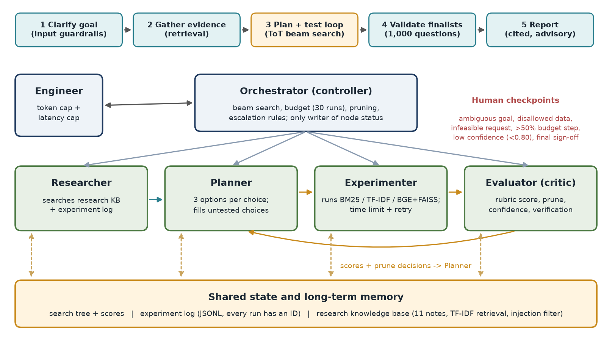

# RAG Pipeline Optimizer

A multi-agent research assistant that finds the best retrieval configuration for a
retrieval-augmented generation (RAG) system under a user's context-token and latency limits.
It combines published research (retrieved from a small knowledge base) with its own
experiments on a public dataset, searches the design space with Tree of Thought beam search,
and returns a recommendation where every number is traceable to a logged experiment. An LLM
reader (Claude Haiku 5.5) then checks the finalists end to end: retrieval plus generated answers.

Capstone project, Pallav Jain. Uses only public data (SQuAD v1.1 dev) and an open embedding
model (`BAAI/bge-small-en-v1.5`).



## The problem

Engineers building RAG systems must choose chunk size, retriever, how many chunks to pass to the
model (top-k), and whether to re-rank. These choices interact, the research is scattered and
sometimes contradicts itself, and the right answer depends on the data and on the budget.
Teams usually settle it by trial and error. This agent does that search systematically and
shows its evidence.

**Intended user:** a software or ML engineer who can state limits such as "at most 400 context
tokens and 5 ms retrieval latency" and wants a recommendation they can verify.

## What it does

Search space: 4 design choices x 3 options = 81 configurations.

| choice | options |
|---|---|
| chunk size (words, 25% overlap) | 64, 128, 256 |
| first-stage retriever | BM25, TF-IDF, BGE dense (`bge-small-en-v1.5` embeddings in a FAISS index) |
| top-k chunks in context | 1, 3, 5 |
| re-ranking over top-20 | none, reciprocal rank fusion (lexical + dense), lexical overlap |

Measured for each configuration: **answer recall** (share of questions whose gold answer appears
in the retrieved context; an upper bound on what a generator could answer), **p95 retrieval
latency** (for BGE this includes embedding the question on the CPU), and **context tokens**
(cost proxy). The search itself never calls an LLM, so it stays free and reproducible.

After the search, an **LLM reader** answers questions from the retrieved chunks for a few
finalist configurations, scored with the official SQuAD **exact match (EM)** and **F1**. This
tests whether the configuration with the best retrieval also gives the best answers.

```
question -> retriever (BM25 / TF-IDF / BGE+FAISS) -> re-rank -> top-k chunks -> Claude Haiku 5.5 -> answer -> EM / F1
            '------------------ searched by the agent (81 configs) ------------------'   '-- finalists only --'
```

## How it works

| component | file | role |
|---|---|---|
| Orchestrator | `rag_optimizer/orchestrator.py` | Beam search controller (width 3, depth 4), budget of 30 sample experiments, pruning, re-planning, escalation rules. Only component that changes node status. |
| Researcher | `agents/researcher.py` | Retrieves evidence from the knowledge base (TF-IDF, top-4, relevance threshold 0.08) and finds earlier runs in the experiment log (filtered by dataset and split). |
| Planner | `agents/planner.py` | Tree of Thought generator: proposes 3 options per choice, fills untested choices using evidence, learns fills from failed constraints. |
| Experimenter | `agents/experimenter.py` | Only role that runs pipelines. Time limit, one retry, every run logged with an ID. |
| Evaluator | `agents/evaluator.py` | Rubric (recall 50%, latency 20%, cost 15%, evidence 15%), hard-constraint pruning, ties, paired-bootstrap confidence. |
| Memory | `rag_optimizer/memory.py` | Knowledge base (11 research notes) and append-only experiment log (JSONL). |
| Retrieval pipeline | `rag_optimizer/pipeline.py` | Chunking, BM25, TF-IDF, BGE + FAISS (`IndexFlatIP`, chunk vectors cached in `data/index/`), RRF and overlap re-ranking, metrics. |
| LLM reader | `rag_optimizer/reader.py` | Claude Haiku 5.5 answers from the retrieved chunks; disk cache, spend ledger with a hard $1 cap, Batch API for bulk runs; SQuAD EM/F1. |
| Guardrails | `rag_optimizer/guardrails.py` | Input checks, dataset allowlist, prompt-injection filter, time limits, budget, report verification. |
| Human gate | `rag_optimizer/human.py` | Interactive or automatic resolution of escalations; every escalation recorded. |

Workflow: clarify goal, gather evidence, plan-and-test loop on 300 questions, validate the top 2
finalists on 1,000 questions, write a cited report. The agent never sees the 2,000-question test
split, which is used only for evaluation.

## Setup

```bash
git clone https://github.com/<your-username>/rag-pipeline-optimizer.git
cd rag-pipeline-optimizer
python -m venv .venv && source .venv/bin/activate      # Windows: .venv\Scripts\activate
pip install -r requirements.txt
python scripts/download_data.py                         # SQuAD dev (5 MB) + bge-small model (~130 MB)
python -m pytest -q                                     # 21 tests, no API key needed
```

Python 3.10 or newer, no GPU. The agent and the tests need no API key. Only the LLM reader does:
put `ANTHROPIC_API_KEY=...` in a `.env` file (git-ignored). FAISS and PyTorch are run
single-threaded (`rag_optimizer/__init__.py`): together they crash on macOS otherwise, and one
thread keeps latency comparable across retrievers.

## Usage

```bash
# Recommend a configuration for a 400-token, 5 ms budget (automatic human-gate policy)
python -m rag_optimizer.cli --max-context-tokens 400 --max-p95-ms 5

# Same, but stop and ask at every human checkpoint
python -m rag_optimizer.cli --max-context-tokens 400 --max-p95-ms 5 --interactive

# Requests the guardrails handle
python -m rag_optimizer.cli --max-context-tokens 50 --max-p95-ms 5                     # infeasible -> escalates
python -m rag_optimizer.cli --max-context-tokens 400 --max-p95-ms 5 --dataset private  # blocked

# Also answer 3 validation questions with Claude Haiku 5.5 using the recommended config (API key needed)
python -m rag_optimizer.cli --max-context-tokens 400 --max-p95-ms 5 --generate 3
```

The report is written to `results/report.md` and the experiment log to
`results/experiment_log.jsonl`. Each request reuses earlier runs from the log.

## Reproduce the evaluation

```bash
python eval/grid.py          # exhaustive 81 configs on the test split -> results/grid_test.csv
python eval/run_eval.py      # 5 scenarios x 4 variants x 5 repeats + safety tests
python eval/summarize.py     # headline metrics -> results/headline_metrics.json
                             # (all three together: ~8 min on an M4 Pro, CPU only)

python eval/run_generation.py --pilot   # 20 LLM calls: measures tokens, cost, latency
python eval/run_generation.py           # <=6 configs x 200 test questions via the Batch API
```

LLM answers are cached in `results/llm_cache.jsonl`, so a rerun costs nothing.

## Results: the agent's search (from `results/headline_metrics.json`)

Five constraint scenarios, five repeats each, judged against exhaustive search of all 81
configurations on the held-out test split (2,000 questions). Metric: answer recall, combined
with latency and cost into a utility score; regret is the utility gap to the exhaustive best.

| metric | v2 (this version) | v1 (GloVe, `results/v1/`) |
|---|---|---|
| Pick within 0.01 / 0.02 utility of the exhaustive best | 64% / 88% of runs | 60% / 76% |
| Mean regret (utility, 0 to 1 scale) | 0.0101 | 0.0115 |
| Experiments per request | 17.2 of 81 (79% fewer than exhaustive) | 17.3 |
| Time per request | 3.7 s | 8.5 s |
| Report numbers verified against the experiment log | 150 of 150 | 150 of 150 |
| Plan-split 95% intervals covering test recall | 100% (58 configurations) | 98.5% (66) |
| Memory reuse across three requests | 24% fewer new experiments | 26% |
| Safety tests (8) | all behaved as designed | all behaved as designed |

Ablations, v2 (mean regret, share within 0.01, experiments):

| variant | mean regret | within 0.01 | experiments |
|---|---|---|---|
| Agent (beam 3, knowledge base) | 0.0101 | 0.64 | 17.2 |
| Greedy single path (beam 1) | 0.0275 | 0.32 | 10.0 |
| No knowledge base | 0.0037 | 1.00 | 17.0 |
| No 0.60 score floor | 0.0087 | 0.60 | 18.2 |

Retrievers on the test split (mean answer recall over each retriever's 27 configurations):
BM25 0.851, TF-IDF 0.843, BGE 0.832. The best configuration overall is BM25 fused with BGE by
RRF (`c256-bm25-k5-rrf`, 0.940), but BM25 alone scores 0.939 at 0.55 ms p95 against 10.1 ms.

Honest reading:
- **Beam search earns its cost here.** The greedy single path has 2.7x the regret.
- **The modern embedding model doesn't pay off on SQuAD.** SQuAD questions were written while
  reading the paragraph, so they share its exact words and lexical retrieval is very strong (the
  DPR paper reports the same). BGE helps only when fused with BM25, by at most 0.001 recall, and
  costs ~10 ms per query on a CPU. The agent never picks it, which is the right call. On data
  where users phrase things differently from the documents, the result would likely differ; not
  tested here.
- **The knowledge base now hurts.** Without it the agent does better (regret 0.0037 vs 0.0101).
  The research notes favour dense retrieval and fusion, which is true in general but not on this
  dataset, so they push the search toward slower options it then has to discard. In v1 the
  knowledge base barely changed the picks. Lesson: literature priors are a starting point; the
  experiments have to be allowed to overrule them.
- **Scenario change in v2:** S4 ("accuracy first") has a 20 ms latency cap instead of 5 ms;
  under 5 ms every BGE and RRF configuration is infeasible, so BGE could not compete at all.
- Low-confidence escalations (24% of runs) stay above the 5-15% target, because many
  configurations tie within noise. See `results/eval_report.md`.


## Results: end to end with an LLM reader (from `results/generation_summary.json`)

Claude Haiku 5.5 (`claude-haiku-5-5`, thinking off, 64-token answers) answered 200 questions
sampled from the held-out test split (seed 7) for 6 configurations: a top-k sweep at the
highest-recall setting, plus three of the agent's picks. 1,200 calls through the Message
Batches API. *EM when retrieved* counts only questions whose gold answer was in the context,
so it measures the reader on its own.

| config | why | recall | EM | F1 | EM when retrieved | answered "not found" | input tokens / call |
|---|---|---|---|---|---|---|---|
| `c256-bm25-k1-rrf` | top-k sweep, k=1 | 0.855 | 0.705 | 0.788 | 0.825 | 15.5% | 624 |
| `c256-bm25-k3-rrf` | top-k sweep, k=3 | 0.935 | 0.750 | 0.844 | 0.802 | 7.0% | 1,685 |
| `c256-bm25-k5-rrf` | top-k sweep, k=5 | 0.950 | 0.775 | 0.847 | 0.816 | 7.0% | 2,739 |
| `c128-bm25-k1-none` | agent pick, S1 tight | 0.815 | 0.690 | 0.742 | 0.847 | 19.5% | 361 |
| `c64-tfidf-k3-overlap` | agent pick, S3 generous | 0.845 | 0.705 | 0.769 | 0.834 | 16.0% | 498 |
| `c128-bm25-k3-none` | agent pick, S4 accuracy first | 0.885 | 0.730 | 0.817 | 0.825 | 10.5% | 894 |

Input tokens are as billed by the API. With 200 questions, differences of about 0.03 are within
noise (one standard error of a 0.75 proportion is ~0.03).

Honest reading:
- **Retrieval recall ranks the configurations the same way answer quality does.** Ordering the
  six by recall and by EM gives the same order, apart from one tie at 0.705. That supports
  the design choice of searching on recall, which is free, and calling the LLM only for finalists.
- **Recall overstates answer quality by 12–19 points.** The reader gets the exact answer for
  about 80–85% of the questions whose answer it was given. Many misses are right but phrased
  longer than SQuAD's gold span: of the 45 misses at k=5, 24 overlap the gold answer ("Entry is
  free" vs "free", "eight appearances" vs "eight"), 14 answered "not found", and 7 were wrong.
  That's why F1 sits above EM, and why EM understates the reader.
- **More context did not hurt the reader at these lengths.** EM when retrieved is flat across
  k = 1, 3, 5 (0.825, 0.802, 0.816, within noise), so the "lost in the middle" effect in the
  knowledge base (`kb08`) doesn't show up at up to ~2,700 tokens. More chunks help overall
  because they retrieve the answer more often, but with diminishing returns: k=5 costs 4.4x the
  tokens of k=1 for +7 EM points, and only +2.5 over k=3.
- **The agent's cost proxy undercounts real tokens.** The search estimates context tokens as
  words x 1.3; Haiku 5.5 bills about 1.6x that (fit across the six configurations, plus ~95
  tokens for the instructions and question). The proxy still ranks configurations correctly, but
  a real token cap should be checked with the provider's token counter.

**Cost:** $0.0725 in total for the project's 1,220 LLM calls (20-call standard-price pilot plus
1,200 batch calls; 1,378,059 input and 10,745 output tokens as reported by the API, at list
price). The code enforces a hard $1 cap across all runs (`results/llm_spend.json`); answers are
cached, so reruns are free. Pilot latency: median 0.63 s per call (`results/generation_pilot.json`).


Charts are regenerated with `python docs/make_charts.py` (architecture: `python docs/make_diagram.py`).

## Repository layout

```
rag_optimizer/        agent package (orchestrator, agents/, memory, guardrails, report, cli)
rag_optimizer/knowledge_base/   11 research notes with citations
eval/                 exhaustive grid, evaluation suite, summary, LLM end-to-end run
tests/                unit and end-to-end tests, injected-document fixture
results/              v2 grid, evaluation and LLM outputs; results/v1/ keeps the GloVe version
docs/                 architecture diagram
scripts/              data download
```

## Limitations

- Agent roles are deterministic Python policies, not LLM calls. The LLM is the reader inside
  the pipeline under test, and only for finalists, not the agent's planner.
- The search optimizes answer recall; generated-answer quality (EM/F1) is measured on 6
  configurations and 200 questions only, to keep the whole project under $1 of API spend.
- One dataset with high lexical overlap (SQuAD), which favours BM25.
- One small embedding model on a CPU; a larger model or a GPU would change the latency trade-off.
- Latency is measured live, so close decisions vary between runs.
- The time limit is a timer, not an operating-system sandbox.

## License

MIT. Data: SQuAD v1.1 (CC BY-SA 4.0). Model: `BAAI/bge-small-en-v1.5` (MIT).
