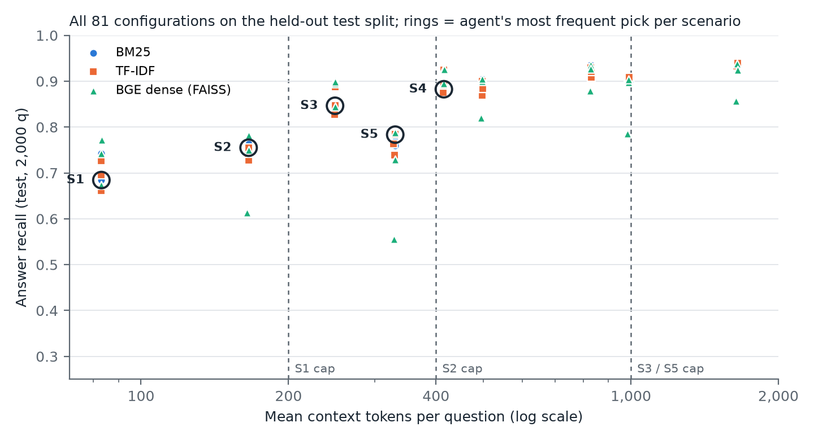

# RAG Pipeline Optimizer

A multi-agent research assistant that finds the best retrieval configuration for a
retrieval-augmented generation (RAG) system under a user's context-token and latency limits.
It combines published research (retrieved from a small knowledge base) with its own
experiments on a public dataset, searches the design space with Tree of Thought beam search,
and returns a recommendation where every number is traceable to a logged experiment. An LLM
reader (Claude Haiku 5.5) then checks the finalists end to end: retrieval plus generated answers.

Built with **LangGraph** (the controller: a state graph with human-in-the-loop interrupts),
**CrewAI** (Researcher, Planner and Evaluator agents on Claude Haiku 5.5) and an **MCP server**
(the agents' shared memory: research search, experiment log, search tree).

Capstone project, Pallav Jain. Uses only public data (SQuAD v1.1 dev) and an open embedding
model (`BAAI/bge-small-en-v1.5`).


## The problem

Engineers building RAG systems must choose chunk size, retriever, how many chunks to pass to the
model (top-k), and whether to re-rank. These choices interact, the research is scattered and
sometimes contradicts itself, and the right answer depends on the data and on the budget.
Teams usually settle it by trial and error. This agent does that search systematically and
shows its evidence.

**Intended user:** a software or ML engineer who can state limits such as "at most 400 context
tokens and 5 ms retrieval latency" and wants a recommendation they can verify.

## What it does

Search space: 4 design choices x 3 options = 81 configurations.

| choice | options |
|---|---|
| chunk size (words, 25% overlap) | 64, 128, 256 |
| first-stage retriever | BM25, TF-IDF, BGE dense (`bge-small-en-v1.5` embeddings in a FAISS index) |
| top-k chunks in context | 1, 3, 5 |
| re-ranking over top-20 | none, reciprocal rank fusion (lexical + dense), lexical overlap |

Measured for each configuration: **answer recall** (share of questions whose gold answer appears
in the retrieved context; an upper bound on what a generator could answer), **p95 retrieval
latency** (for BGE this includes embedding the question on the CPU), and **context tokens**
(cost proxy). Scores come only from these measurements: the LLM agents shape what gets tested
and explain it, but never score, prune or invent numbers.

After the search, an **LLM reader** answers questions from the retrieved chunks for a few
finalist configurations, scored with the official SQuAD **exact match (EM)** and **F1**. This
tests whether the configuration with the best retrieval also gives the best answers.

```
question -> retriever (BM25 / TF-IDF / BGE+FAISS) -> re-rank -> top-k chunks -> Claude Haiku 5.5 -> answer -> EM / F1
            '------------------ searched by the agent (81 configs) ------------------'   '-- finalists only --'
```

## How it works

| component | framework | file | role |
|---|---|---|---|
| Controller | **LangGraph** | `rag_optimizer/graph.py`, `orchestrator.py` | `StateGraph`: clarify → evidence → expand → test → evaluate (loops to depth 4) → validate → finalize. Beam search (width 3, depth 4), budget of 30 sample experiments, pruning, re-planning, backtracking. Human checkpoints are a graph node that calls `interrupt()` in interactive mode and resumes with `Command(resume=...)`. Only the controller changes node status. |
| Researcher | **CrewAI** + MCP | `rag_optimizer/crew.py` | Searches the research notes through the MCP tool `search_research` and judges, per design option, whether the literature supports it (stance, strength, note IDs). Uncited or invalid items are dropped. |
| Planner | **CrewAI** | `crew.py`, `agents/planner.py` | Tree of Thought thought generator: writes the Thought for each of the 3 branches and chooses the fills for still-undecided choices (validated against the allowed options and the token cap), so it decides which configurations get tested. Writes the final summary. |
| Experimenter | tool (no LLM) | `agents/experimenter.py` | Only role that runs pipelines. Time limit, one retry, every run logged with an ID. |
| Evaluator (critic) | code + **CrewAI** + MCP | `agents/evaluator.py`, `crew.py` | Code: rubric (recall 50%, latency 20%, cost 15%, evidence 15%), hard-constraint pruning, ties, paired-bootstrap confidence. LLM critic: reads the tree through the MCP tool `get_tree`, flags literature-vs-measurement conflicts. |
| Shared memory | **MCP server** | `rag_optimizer/mcp_server.py` | stdio server with `search_research`, `search_experiments`, `get_tree` (read-only; injection-filtered knowledge base). |
| Memory | | `rag_optimizer/memory.py` | Knowledge base (11 research notes) and append-only experiment log (JSONL). |
| Retrieval pipeline | FAISS, sentence-transformers | `rag_optimizer/pipeline.py` | Chunking, BM25, TF-IDF, BGE + FAISS (`IndexFlatIP`, chunk vectors cached in `data/index/`), RRF and overlap re-ranking, metrics. |
| LLM reader | Anthropic SDK | `rag_optimizer/reader.py` | Claude Haiku 5.5 answers from the retrieved chunks; disk cache, Batch API, SQuAD EM/F1. |
| Guardrails | | `rag_optimizer/guardrails.py`, `crew.py`, `reader.py` | Input checks, dataset allowlist, prompt-injection filter, time limits, budget, report verification, removal of agent sentences with uncited numbers, rule-based fallback for any failed agent step, a hard $1 LLM spend cap shared by all LLM calls. |
| Human gate | LangGraph `interrupt()` | `rag_optimizer/human.py` | Interactive or automatic resolution of escalations; every escalation recorded. |

Two agent teams run inside the same graph: `--agents llm` (CrewAI, the capstone system) and
`--agents rule` (deterministic Python policies: free, repeatable, used for the large evaluation
suite and as a baseline). Tests check that the LangGraph controller makes exactly the same
decisions as the earlier plain-Python loop on 13 scenarios (`tests/test_graph.py`).

Workflow: clarify goal, gather evidence, plan-and-test loop on 300 questions, validate the top 2
finalists on 1,000 questions, write a cited report. The agent never sees the 2,000-question test
split, which is used only for evaluation.

## Setup

```bash
git clone https://github.com/<your-username>/rag-pipeline-optimizer.git
cd rag-pipeline-optimizer
python -m venv .venv && source .venv/bin/activate      # Windows: .venv\Scripts\activate
pip install -r requirements.txt
python scripts/download_data.py                         # SQuAD dev (5 MB) + bge-small model (~130 MB)
python -m pytest -q                                     # 40 tests, no API key needed
```

Python 3.10 or newer, no GPU. The agent and the tests need no API key. Only the LLM reader does:
put `ANTHROPIC_API_KEY=...` in a `.env` file (git-ignored). FAISS and PyTorch are run
single-threaded (`rag_optimizer/__init__.py`): together they crash on macOS otherwise, and one
thread keeps latency comparable across retrievers.

## Usage

```bash
# Recommend a configuration for a 400-token, 5 ms budget with the CrewAI agents (API key needed)
python -m rag_optimizer.cli --max-context-tokens 400 --max-p95-ms 5 --agents llm

# Same with the rule-based agents (free, no API key)
python -m rag_optimizer.cli --max-context-tokens 400 --max-p95-ms 5

# Stop and ask at every human checkpoint (LangGraph interrupt, resumed from your answer)
python -m rag_optimizer.cli --max-context-tokens 400 --max-p95-ms 5 --interactive

# Requests the guardrails handle
python -m rag_optimizer.cli --max-context-tokens 50 --max-p95-ms 5                     # infeasible -> escalates
python -m rag_optimizer.cli --max-context-tokens 400 --max-p95-ms 5 --dataset private  # blocked

# Also answer 3 validation questions with Claude Haiku 5.5 using the recommended config (API key needed)
python -m rag_optimizer.cli --max-context-tokens 400 --max-p95-ms 5 --generate 3
```

The report is written to `results/report.md` and the experiment log to
`results/experiment_log.jsonl`. Each request reuses earlier runs from the log.

## Reproduce the evaluation

```bash
python eval/grid.py          # exhaustive 81 configs on the test split -> results/grid_test.csv
python eval/run_eval.py      # 5 scenarios x 4 variants x 5 repeats + safety tests
python eval/summarize.py     # headline metrics -> results/headline_metrics.json
                             # (all three together: ~8 min on an M4 Pro, CPU only)

python eval/run_llm_eval.py             # CrewAI agents vs rule agents: 5 scenarios x 2 + safety
python eval/run_generation.py --pilot   # 20 LLM calls: measures tokens, cost, latency
python eval/run_generation.py           # <=6 configs x 200 test questions via the Batch API
```

LLM answers are cached in `results/llm_cache.jsonl`, so a rerun costs nothing.

## Results: the agent's search (from `results/headline_metrics.json`)

Five constraint scenarios, five repeats each, judged against exhaustive search of all 81
configurations on the held-out test split (2,000 questions). Metric: answer recall, combined
with latency and cost into a utility score; regret is the utility gap to the exhaustive best.
This large suite (100 runs plus ablations and safety tests) uses the **rule-based agent team**
inside the LangGraph controller, so it is free and repeatable; the CrewAI team is compared
against it in the next section.

| metric | v3 (LangGraph, rule agents) | v2 (plain loop) | v1 (GloVe, `results/v1/`) |
|---|---|---|---|
| Pick within 0.01 / 0.02 utility of the exhaustive best | 92% / 100% of runs | 64% / 88% | 60% / 76% |
| Mean regret (utility, 0 to 1 scale) | 0.0055 | 0.0101 | 0.0115 |
| Experiments per request | 17.5 of 81 (78% fewer than exhaustive) | 17.2 | 17.3 |
| Time per request | 3.9 s | 3.7 s | 8.5 s |
| Report numbers verified against the experiment log | 135 of 135 | 150 of 150 | 150 of 150 |
| Plan-split 95% intervals covering test recall | 100% (56 configurations) | 100% (58) | 98.5% (66) |
| Memory reuse across three requests | 24% fewer new experiments | 24% | 26% |
| Low-confidence escalations | 4% of runs | 24% | 28% |
| Safety tests (8) | all behaved as designed | all as designed | all as designed |

**Why v2 and v3 differ:** not the controller. `tests/test_graph.py` feeds both controllers
identical measurements and they make identical decisions in all 13 scenarios. The difference is
run-to-run variation: latency is measured live, and many configurations tie within a few
thousandths of utility, so small timing changes flip picks between near-equals. Both runs are
reported; neither was cherry-picked.

Ablations, v3 (mean regret, share within 0.01, experiments):

| variant | mean regret | within 0.01 | experiments |
|---|---|---|---|
| Agent (beam 3, knowledge base) | 0.0055 | 0.92 | 17.5 |
| Greedy single path (beam 1) | 0.0206 | 0.52 | 10.2 |
| No knowledge base | 0.0055 | 0.76 | 16.8 |
| No 0.60 score floor | 0.0128 | 0.40 | 18.6 |

Retrievers on the test split (mean answer recall over each retriever's 27 configurations):
BM25 0.851, TF-IDF 0.843, BGE 0.832. The best configuration overall is BM25 fused with BGE by
RRF (`c256-bm25-k5-rrf`, 0.940), but BM25 alone scores 0.939 at 0.55 ms p95 against 10.1 ms.

Honest reading:
- **Beam search earns its cost.** The greedy single path has 3.7x the regret (v2: 2.7x).
- **The modern embedding model doesn't pay off on SQuAD.** SQuAD questions were written while
  reading the paragraph, so they share its exact words and lexical retrieval is very strong (the
  DPR paper reports the same). BGE helps only when fused with BM25, by at most 0.001 recall, and
  costs ~10 ms per query on a CPU. The agent never picks it, which is the right call. On data
  where users phrase things differently from the documents, the result would likely differ; not
  tested here.
- **The knowledge base's effect is within noise.** In the v2 run the agent without it did better
  (regret 0.0037 vs 0.0101); in the v3 run they tie on regret (0.0055) and the agent with it is
  within 0.01 more often (92% vs 76%). The notes mainly provide citations and conflict detection.
- **Scenario change in v2:** S4 ("accuracy first") has a 20 ms latency cap instead of 5 ms;
  under 5 ms every BGE and RRF configuration is infeasible, so BGE could not compete at all.
- Low-confidence escalations fell to 4% of runs in v3, just under the 5–15% target (24% in v2):
  this rate moves with the same timing noise. See `results/eval_report.md`.




## Results: CrewAI agents vs rule-based agents (from `results/llm_agents_eval.json`)

Same LangGraph controller, same scoring and pruning code; only the agent team differs. LLM mode
ran 2 repeats per scenario (to stay inside the $1 budget), rule mode 5. Each run starts with an
empty experiment log.

| scenario | regret, CrewAI | regret, rules | within 0.01, CrewAI | within 0.01, rules | experiments, CrewAI / rules | seconds per run, CrewAI / rules | $ per run, CrewAI |
|---|---|---|---|---|---|---|---|
| S1 tight (200 tokens, 5 ms) | 0.0131 | 0.0074 | 1 of 2 | 5 of 5 | 12.5 / 12 | 49 / 3.8 | $0.0061 |
| S2 balanced (400 tokens, 5 ms) | 0.0673 | 0.0084 | 0 of 2 | 3 of 5 | 8.5 / 17.2 | 43 / 4.0 | $0.0055 |
| S3 generous (1,000 tokens, 5 ms) | 0.0000 | 0.0031 | 2 of 2 | 5 of 5 | 25 / 23.2 | 49 / 4.6 | $0.0068 |
| S4 accuracy first (2,000 tokens, 20 ms) | 0.0129 | 0.0061 | 0 of 2 | 5 of 5 | 24.5 / 21 | 52 / 4.9 | $0.0071 |
| S5 low latency (1,000 tokens, 0.5 ms) | no pick | 0.0025 | 0 of 2 | 5 of 5 | 13 / 14 | 39 / 2.2 | $0.0053 |

No agent step fell back to rules in these 10 runs (every LLM output passed validation), and every
cited number in the 8 reports with a recommendation matched the experiment log.

Honest reading:
- **The LLM agents did not beat the rules.** They tied or won on S3 and lost on S1, S2 and S4.
  On S2 the Planner's fills steered the search toward 256-word chunks with top-1 and it stopped
  after 8–9 experiments, missing the better 64-word, top-3 settings. With 2 repeats per
  scenario this is a small sample, but the direction is consistent.
- **On S5 (0.5 ms cap) both LLM runs ended without a recommendation:** the finalists measured
  over the latency cap on the validation split, so the run stopped and escalated, as designed.
  The rule runs passed. A likely cause, not verified, is that latency is measured in the same
  process while the agents' MCP servers start and stop, which adds timing noise at a cap this
  tight. Measuring in an isolated worker would fix it.
- **Cost and time:** about $0.006 and 45 s per request, against $0 and 4 s for the rules.
- **What the LLM agents add:** readable reasoning. Each report shows the Researcher's cited
  evidence, the Planner's Thought for every kept branch, the critic's assessment per level and
  its literature-vs-measurement conflicts (for example "retriever=bge (kb05, kb11)"), and a
  written summary whose only numbers are cited ones. Sample: `results/reports/S2_balanced_llm_agents.md`.
- **Takeaway:** for a search whose scoring is fully measurable, LLM agents are best used to
  explain and to propose, with code deciding. Letting the LLM choose fills cost accuracy here; a
  next step is to let it propose fills but keep the rule fill whenever the evidence is weak.

Safety checks in LLM mode: the prompt-injection note was quarantined before the agents saw it;
no agent cited it and the injected target was not recommended. A denied high-impact step stopped
the run, through the LangGraph human checkpoint.

## Results: end to end with an LLM reader (from `results/generation_summary.json`)

Claude Haiku 5.5 (`claude-haiku-5-5`, thinking off, 64-token answers) answered 200 questions
sampled from the held-out test split (seed 7) for 6 configurations: a top-k sweep at the
highest-recall setting, plus three of the agent's picks. 1,200 calls through the Message
Batches API. *EM when retrieved* counts only questions whose gold answer was in the context,
so it measures the reader on its own.

| config | why | recall | EM | F1 | EM when retrieved | answered "not found" | input tokens / call |
|---|---|---|---|---|---|---|---|
| `c256-bm25-k1-rrf` | top-k sweep, k=1 | 0.855 | 0.705 | 0.788 | 0.825 | 15.5% | 624 |
| `c256-bm25-k3-rrf` | top-k sweep, k=3 | 0.935 | 0.750 | 0.844 | 0.802 | 7.0% | 1,685 |
| `c256-bm25-k5-rrf` | top-k sweep, k=5 | 0.950 | 0.775 | 0.847 | 0.816 | 7.0% | 2,739 |
| `c128-bm25-k1-none` | agent pick, S1 tight | 0.815 | 0.690 | 0.742 | 0.847 | 19.5% | 361 |
| `c64-tfidf-k3-overlap` | agent pick, S3 generous | 0.845 | 0.705 | 0.769 | 0.834 | 16.0% | 498 |
| `c128-bm25-k3-none` | agent pick, S4 accuracy first | 0.885 | 0.730 | 0.817 | 0.825 | 10.5% | 894 |

Input tokens are as billed by the API. With 200 questions, differences of about 0.03 are within
noise (one standard error of a 0.75 proportion is ~0.03).

Honest reading:
- **Retrieval recall ranks the configurations the same way answer quality does.** Ordering the
  six by recall and by EM gives the same order, apart from one tie at 0.705. That supports
  the design choice of searching on recall, which is free, and calling the LLM only for finalists.
- **Recall overstates answer quality by 12–19 points.** The reader gets the exact answer for
  about 80–85% of the questions whose answer it was given. Many misses are right but phrased
  longer than SQuAD's gold span: of the 45 misses at k=5, 24 overlap the gold answer ("Entry is
  free" vs "free", "eight appearances" vs "eight"), 14 answered "not found", and 7 were wrong.
  That's why F1 sits above EM, and why EM understates the reader.
- **More context did not hurt the reader at these lengths.** EM when retrieved is flat across
  k = 1, 3, 5 (0.825, 0.802, 0.816, within noise), so the "lost in the middle" effect in the
  knowledge base (`kb08`) doesn't show up at up to ~2,700 tokens. More chunks help overall
  because they retrieve the answer more often, but with diminishing returns: k=5 costs 4.4x the
  tokens of k=1 for +7 EM points, and only +2.5 over k=3.
- **The agent's cost proxy undercounts real tokens.** The search estimates context tokens as
  words x 1.3; Haiku 5.5 bills about 1.6x that (fit across the six configurations, plus ~95
  tokens for the instructions and question). The proxy still ranks configurations correctly, but
  a real token cap should be checked with the provider's token counter.

**Cost of this end-to-end run:** $0.0725 for 1,220 LLM calls (20-call standard-price pilot plus
1,200 batch calls; 1,378,059 input and 10,745 output tokens as reported by the API, at list
price). Answers are cached, so reruns are free. Pilot latency: median 0.63 s per call
(`results/generation_pilot.json`).

**Total LLM spend for the whole project: $0.161** over 1,429 calls (this run, the CrewAI agent
evaluation, smoke tests), from API-reported tokens at list price in `results/llm_spend.json`. The
code enforces a hard $1 cap across every LLM call, reader and agents alike.


Charts are regenerated with `python docs/make_charts.py` (architecture: `python docs/make_diagram.py`).

## Repository layout

```
rag_optimizer/        graph.py (LangGraph), crew.py (CrewAI), mcp_server.py (MCP), orchestrator, agents/,
                      pipeline, reader, memory, guardrails, report, cli
rag_optimizer/knowledge_base/   11 research notes with citations
eval/                 exhaustive grid, evaluation suite, LLM-agent evaluation, LLM end-to-end run
tests/                unit, graph-regression, MCP, CrewAI (fake LLM) and end-to-end tests
results/              grid, evaluation and LLM outputs, sample reports; results/v1/ keeps the GloVe version
docs/                 architecture diagram and charts
scripts/              data download
PLAN.md               build plans for v2 and v3, with results per step
```

## Design vs. the capstone checkpoints

| checkpoint | design | built | note |
|---|---|---|---|
| CP2 | ReAct loop, short- and long-term memory, tools | Graph loop (plan → act → observe → re-plan) with short-term state in the graph and long-term memory in the experiment log and knowledge base | The re-plan step is the ReAct "observation changes the next action" pattern |
| CP3 | Research knowledge base in a vector DB with sentence embeddings, cross-encoder re-ranking, ~450-token chunks, threshold 0.35 | 11 short research notes, TF-IDF search with a 0.08 threshold, exposed through MCP; dense retrieval (BGE + FAISS) is in the pipeline under test | 11 notes are too few for a vector DB to matter; the embedding stack is evaluated where it changes results |
| CP4 | ToT beam search: width 3, depth 4, 30 nodes, rubric 50/20/15/15, 0.60 floor, 15% gap, 0.02 ties, backtracking, top-2 validation | Built as designed (`graph.py`, `agents/evaluator.py`) | Sample size 300 questions instead of 100 (100 was too noisy to separate close configurations) |
| CP4 §2d | CrewAI Planner and Evaluator, LangChain LCEL controller, MCP server for state | CrewAI Researcher, Planner and Evaluator; **LangGraph** controller; MCP server | LangGraph replaces LCEL: the controller is a loop with branches and human pauses, which a state graph expresses directly |
| CP5 | 4 agents + non-LLM orchestrator, shared blackboard, Planner–Evaluator feedback loop | As designed; the Experimenter is a tool rather than an LLM agent | An LLM adds nothing to running code; keeping it a tool saves cost |
| CP6 | Input checks, least-privilege tools, source verification, output constraints, monitoring, human checkpoints, fallback logic, metrics | All built, plus a rule-based fallback for every LLM agent step and removal of agent sentences with uncited numbers; see the safety results above | The low-confidence escalation rate moves with timing noise (24% in v2, 4% in v3) |

## Limitations

- The LLM agents run on a small model (Haiku 5.5) with a $1 total budget, so LLM mode was evaluated
  on 2 repeats per scenario, against 5 for the rule-based team; its results vary between runs.
- The search optimizes answer recall; generated-answer quality (EM/F1) is measured on 6
  configurations and 200 questions only, to keep the whole project under $1 of API spend.
- One dataset with high lexical overlap (SQuAD), which favours BM25.
- One small embedding model on a CPU; a larger model or a GPU would change the latency trade-off.
- Latency is measured live, so close decisions vary between runs.
- The time limit is a timer, not an operating-system sandbox.

## License

MIT. Data: SQuAD v1.1 (CC BY-SA 4.0). Model: `BAAI/bge-small-en-v1.5` (MIT).
