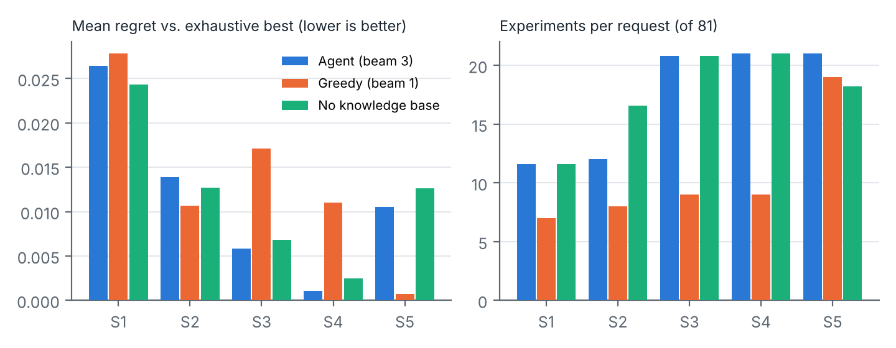

# RAG Pipeline Optimizer

A multi-agent research assistant that finds the best retrieval configuration for a
retrieval-augmented generation (RAG) system under a user's context-token and latency limits.
It combines published research (retrieved from a small knowledge base) with its own
experiments on a public dataset, searches the design space with Tree of Thought beam search,
and returns a recommendation where every number is traceable to a logged experiment.

Capstone project, Pallav Jain. Uses only public data (SQuAD v1.1 dev, GloVe vectors).


## The problem

Engineers building RAG systems must choose chunk size, retriever, how many chunks to pass to the
model (top-k), and whether to re-rank. These choices interact, the research is scattered and
sometimes contradicts itself, and the right answer depends on the data and on the budget.
Teams usually settle it by trial and error. This agent does that search systematically and
shows its evidence.

**Intended user:** a software or ML engineer who can state limits such as "at most 400 context
tokens and 5 ms retrieval latency" and wants a recommendation they can verify.

## What it does

Search space: 4 design choices x 3 options = 81 configurations.

| choice | options |
|---|---|
| chunk size (words, 25% overlap) | 64, 128, 256 |
| first-stage retriever | BM25, TF-IDF, GloVe dense (IDF-weighted average) |
| top-k chunks in context | 1, 3, 5 |
| re-ranking over top-20 | none, reciprocal rank fusion (lexical + dense), lexical overlap |

Measured for each configuration: **answer recall** (share of questions whose gold answer appears
in the retrieved context; an upper bound on what a generator could answer), **p95 retrieval
latency**, and **context tokens** (cost proxy). Generation itself is out of scope.

## How it works

| component | file | role |
|---|---|---|
| Orchestrator | `rag_optimizer/orchestrator.py` | Beam search controller (width 3, depth 4), budget of 30 sample experiments, pruning, re-planning, escalation rules. Only component that changes node status. |
| Researcher | `agents/researcher.py` | Retrieves evidence from the knowledge base (TF-IDF, top-4, relevance threshold 0.08) and finds earlier runs in the experiment log (filtered by dataset and split). |
| Planner | `agents/planner.py` | Tree of Thought generator: proposes 3 options per choice, fills untested choices using evidence, learns fills from failed constraints. |
| Experimenter | `agents/experimenter.py` | Only role that runs pipelines. Time limit, one retry, every run logged with an ID. |
| Evaluator | `agents/evaluator.py` | Rubric (recall 50%, latency 20%, cost 15%, evidence 15%), hard-constraint pruning, ties, paired-bootstrap confidence. |
| Memory | `rag_optimizer/memory.py` | Knowledge base (10 research notes) and append-only experiment log (JSONL). |
| Guardrails | `rag_optimizer/guardrails.py` | Input checks, dataset allowlist, prompt-injection filter, time limits, budget, report verification. |
| Human gate | `rag_optimizer/human.py` | Interactive or automatic resolution of escalations; every escalation recorded. |

Workflow: clarify goal, gather evidence, plan-and-test loop on 300 questions, validate the top 2
finalists on 1,000 questions, write a cited report. The agent never sees the 2,000-question test
split, which is used only for evaluation.

## Setup

```bash
git clone https://github.com/<your-username>/rag-pipeline-optimizer.git
cd rag-pipeline-optimizer
python -m venv .venv && source .venv/bin/activate      # Windows: .venv\Scripts\activate
pip install -r requirements.txt
python scripts/download_data.py                         # SQuAD dev (5 MB) + GloVe 50d (69 MB)
python -m pytest -q                                     # 16 tests
```

Python 3.10 or newer. No API keys or GPU needed.

## Usage

```bash
# Recommend a configuration for a 400-token, 5 ms budget (automatic human-gate policy)
python -m rag_optimizer.cli --max-context-tokens 400 --max-p95-ms 5

# Same, but stop and ask at every human checkpoint
python -m rag_optimizer.cli --max-context-tokens 400 --max-p95-ms 5 --interactive

# Requests the guardrails handle
python -m rag_optimizer.cli --max-context-tokens 50 --max-p95-ms 5                     # infeasible -> escalates
python -m rag_optimizer.cli --max-context-tokens 400 --max-p95-ms 5 --dataset private  # blocked
```

The report is written to `results/report.md` and the experiment log to
`results/experiment_log.jsonl`. Each request reuses earlier runs from the log.

## Reproduce the evaluation

```bash
python eval/grid.py          # exhaustive 81 configs on the test split (~3 min) -> results/grid_test.csv
python eval/run_eval.py      # 5 scenarios x 4 variants x 5 repeats + safety tests (~14 min)
python eval/summarize.py     # headline metrics -> results/headline_metrics.json
```

## Results (from `results/headline_metrics.json`)

Five constraint scenarios, five repeats each, judged against exhaustive search on the held-out
test split.

| metric | result |
|---|---|
| Pick within 0.01 / 0.02 utility of the exhaustive best | 60% / 76% of runs |
| Mean regret (utility, 0 to 1 scale) | 0.0115 |
| Experiments per request | 17.3 of 81 (79% fewer than exhaustive) |
| Time per request | 8.5 s |
| Report numbers verified against the experiment log | 150 of 150 |
| Plan-split 95% intervals covering test recall | 98.5% (66 configurations) |
| Memory reuse across three requests | 26% fewer new experiments |
| Safety tests (8) | all behaved as designed |

Ablations (mean regret, share within 0.01, experiments):

| variant | mean regret | within 0.01 | experiments |
|---|---|---|---|
| Agent (beam 3, knowledge base) | 0.0115 | 0.60 | 17.3 |
| Greedy single path (beam 1) | 0.0135 | 0.48 | 10.4 |
| No knowledge base | 0.0118 | 0.48 | 17.6 |
| No 0.60 score floor | 0.0134 | 0.52 | 18.8 |

Honest reading: the agent reliably lands near the best configuration at a fifth of the cost of
exhaustive search. Beam search beat the greedy path on the two larger scenarios but not overall
by much, and costs about two-thirds more experiments. The knowledge base mainly provides citations and
conflict detection; it barely changes the picks. Low-confidence escalations (28% of runs) are
above the 5-15% target because many configurations tie within noise. When finalists are that
close, the automatic default ("choose the cheaper one") can give up recall; in interactive mode a
person makes that call. See `results/eval_report.md`.




Charts are regenerated with `python docs/make_charts.py` (architecture: `python docs/make_diagram.py`).

## Repository layout

```
rag_optimizer/        agent package (orchestrator, agents/, memory, guardrails, report, cli)
rag_optimizer/knowledge_base/   10 research notes with citations
eval/                 exhaustive grid, evaluation suite, summary
tests/                unit and end-to-end tests, injected-document fixture
results/              grid, evaluation outputs, sample reports, experiment log
docs/                 architecture diagram
scripts/              data download
```

## Limitations

- Agent roles are deterministic Python policies, not LLM calls; there is no LLM API dependency.
- Measures retrieval (answer recall), not generated-answer quality.
- One dataset with high lexical overlap (SQuAD), which favours BM25.
- Latency is measured live, so close decisions vary between runs.
- The time limit is a timer, not an operating-system sandbox.

## License

MIT. Data: SQuAD v1.1 (CC BY-SA 4.0), GloVe (Public Domain Dedication and License).
